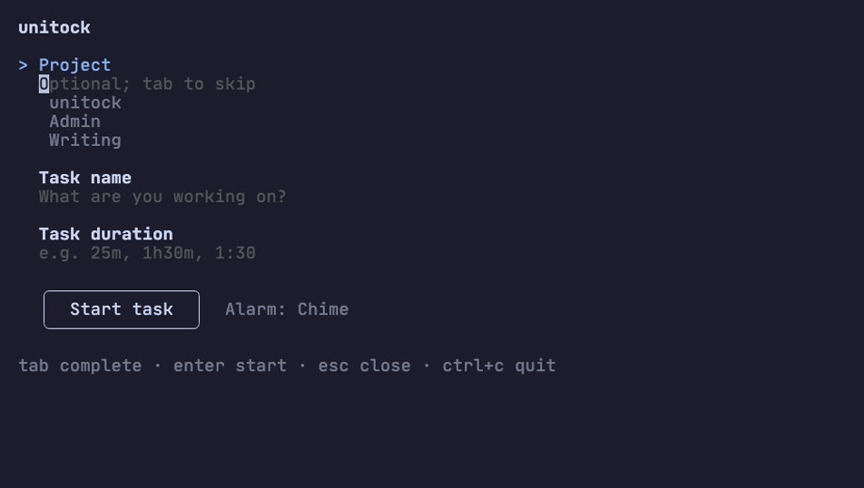
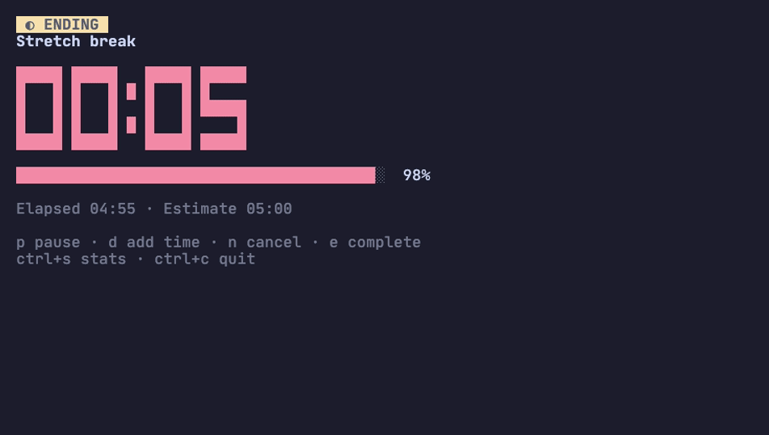
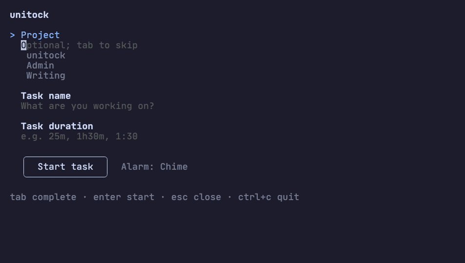
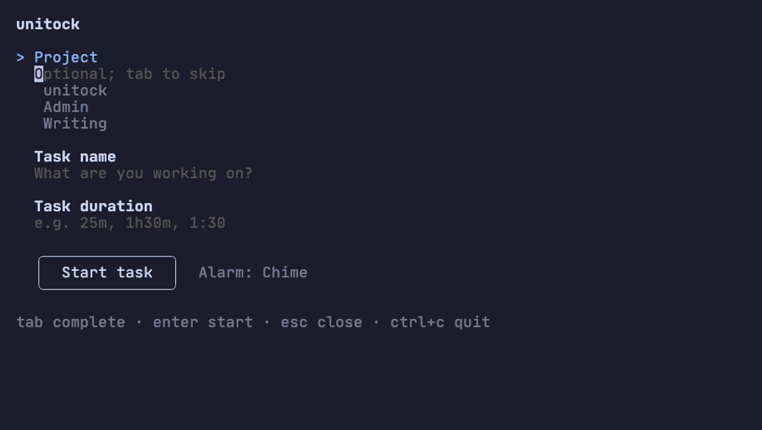

# unitock

[](CHANGELOG.md)
[](docs/PLAN.md)
[](https://github.com/azntaiji/unitock/actions)
[](https://semver.org/spec/v2.0.0.html)
[](https://www.conventionalcommits.org/en/v1.0.0/)
[](LICENSE)

unitock is a terminal time tracker for one task at a time, for macOS and Ubuntu. Name a
task, give it a duration in plain language (`45m`, `1.5 hours`), and watch a colour-shifting
countdown; when time is up it alerts you on screen, with a system notification, and with a
looping alarm sound until you extend or complete the task. A stats screen compares actual
with estimated time over 7 days, 30 days, or 3 months, and everything exports to JSON.
Status: 1.0.0 is released, with every requirement verified end to end on macOS and
Ubuntu; see the [CHANGELOG](CHANGELOG.md).



## Key features

<!-- BEGIN:features (shipped features only; updated at gate close) -->
- Start a task with a name and a plain-language duration: `30m`, `45 minutes`, `1hr`,
  `2.25 hours`, `1h30m`, `1 hr 30 min`, `90` (minutes), or `1:30`; 1 minute to 24 hours.
- Optionally file the task under a project; the Project input suggests existing ones as
  you type (`tab` completes, `↑`/`↓` choose). Names match ignoring case, including
  accented letters ("über" is "Über").
- Watch a large block-digit countdown with a progress bar and a status badge (`● RUNNING`,
  `◐ ENDING`, `▲ OVERTIME`, `❚❚ PAUSED`), coloured from your terminal's palette as time
  runs low; `+MM:SS` once over the estimate. Beneath it, elapsed time and the estimate,
  with any time you added (`Elapsed 32:31 · Estimate 25:00 + 10:00 added`). `NO_COLOR`
  is respected.
- `p` pauses and resumes, `d` adds time, `n` cancels (after a confirmation), and `e`
  completes the task with a motivational message.
- At zero, an alert offers Extend or Mark as completed, with a system notification and a
  looping alarm sound until you choose (terminal bell if no audio player works).
- Five alarm sounds (Chime, Bell, Beep, Marimba, Rising): `ctrl+o` on the Start screen
  previews each as you highlight it and saves your choice.
- App-wide commands are `ctrl` chords, so they work even while typing: `ctrl+s` Stats,
  `ctrl+o` alarm sound, `ctrl+c` quit.
- Quit any time: the task keeps running, and relaunching picks it up with the time spent
  away counted.
- Everything is stored in SQLite in `--data-dir` (default `$XDG_DATA_HOME/unitock` or
  `~/.local/share/unitock`).
- Stats (from Start or the Active screen; the timer keeps running): completed tasks and
  average per day against the previous period, and a bar chart of estimated vs actual
  time, for 7 days, 30 days, or 3 months (`tab` cycles).
- `e` on Stats exports every task, with pauses and extensions, to
  `unitock-export-YYYYMMDD-HHMMSS.json` in the current directory (JSON schema v1); it
  never overwrites a file.
- One instance per data directory; terminals smaller than 60×20 get a resize message.
<!-- END:features -->

## Install

**From a release.** Each [GitHub Release](https://github.com/azntaiji/unitock/releases)
has a static binary for macOS and Linux, on amd64 and arm64. Pick the archive for your
system (`darwin_arm64`, `darwin_amd64`, `linux_amd64`, or `linux_arm64`):

```sh
VERSION=1.0.0 TARGET=linux_amd64
curl -LO "https://github.com/azntaiji/unitock/releases/download/v${VERSION}/unitock_${VERSION}_${TARGET}.tar.gz"
curl -LO "https://github.com/azntaiji/unitock/releases/download/v${VERSION}/checksums.txt"
grep "_${TARGET}.tar.gz" checksums.txt | shasum -a 256 -c   # sha256sum -c on Linux
tar xzf "unitock_${VERSION}_${TARGET}.tar.gz" unitock
mkdir -p ~/.local/bin && mv unitock ~/.local/bin/          # make sure it is on your PATH
unitock --version
```

On macOS, a binary downloaded with a web browser is quarantined and Gatekeeper blocks it
(the binaries are not notarised). Downloading with `curl` as above avoids this; otherwise
run `xattr -d com.apple.quarantine ~/.local/bin/unitock` once.

**With Go** (1.26 or newer):

```sh
go install github.com/azntaiji/unitock/cmd/unitock@latest
```

**On Ubuntu**, the alarm sound and notification use standard desktop tools. Without them
unitock still works, ringing the terminal bell instead of a sound:

```sh
sudo apt install pulseaudio-utils libnotify-bin   # paplay and notify-send
```

macOS needs nothing extra (`afplay` and `osascript` are built in).

## Usage

```sh
unitock                     # data in $XDG_DATA_HOME/unitock or ~/.local/share/unitock
unitock --data-dir DIR      # keep the data somewhere else
unitock --version
```

Type a project (optional), a task name, and a duration, then press `enter`. Every screen
shows the keys that work right now at the bottom; these are all of them:

| Where | Keys |
|---|---|
| Anywhere | `ctrl+c` quit (a running task keeps going) |
| Start | `tab` / `shift+tab` move between fields · `enter` start · `esc` to the button · `ctrl+s` Stats · `ctrl+o` alarm sound |
| Running task | `p` pause or resume · `d` add time · `n` cancel · `e` complete · `ctrl+s` Stats |
| Time's up | `←` / `→` choose · `enter` select · `d` extend · `e` complete |
| Stats | `tab` next period · `e` export to JSON · `esc` back |
| Alarm sound | `↑` / `↓` highlight and preview · `enter` save · `esc` back |

### Tour

When time runs out, the alert stays up and the alarm loops until you extend or complete:



`ctrl+s` opens Stats from anywhere; `tab` steps through the periods:



`ctrl+o` on the Start screen chooses the alarm sound, playing each one as you go:



The GIFs are recorded with [vhs](https://github.com/charmbracelet/vhs) from the tapes in
[docs/demo/](docs/demo/), against generated data: `make demo` re-records them.

## Build from source

<!-- BEGIN:quickstart (must match the Commands table in AGENTS.md) -->
Requires Go 1.26 or newer.

```sh
go mod download
make check          # build, vet, lint, race tests
./bin/unitock --version
./bin/unitock       # or: ./bin/unitock --data-dir DIR
```
<!-- END:quickstart -->

## Roadmap

<!-- BEGIN:roadmap (mirrors docs/PLAN.md; updated at gate close) -->
| Phase | Goal | Status |
|---|---|---|
| 0 | Foundations: spec, plan, tooling | Done |
| 1 | Walking skeleton: start, countdown, complete, resume | Done (v0.1.0) |
| 2 | Active screen and time-up alert | Done (v0.2.0) |
| 3 | Stats and export | Done (v0.3.0) |
| 4 | Hardening and 1.0.0 | Done (v1.0.0) |
| 5 | Not yet planned | Planned |
<!-- END:roadmap -->

Status values: Planned, In progress, Awaiting gate, Done (vX.Y.Z).

## How this project is built

Work proceeds in phases. Each phase ends at a gate that a named person approves, and
every release follows [Semantic Versioning 2.0.0](https://semver.org/spec/v2.0.0.html).
See [docs/PLAN.md](docs/PLAN.md) for phases and [CHANGELOG.md](CHANGELOG.md) for
releases.

## Contributing

See [CONTRIBUTING.md](CONTRIBUTING.md) for the workflow, commit format, and how gates
and versions work. Coding agents start from [AGENTS.md](AGENTS.md).

## License

MIT. See [LICENSE](LICENSE).
